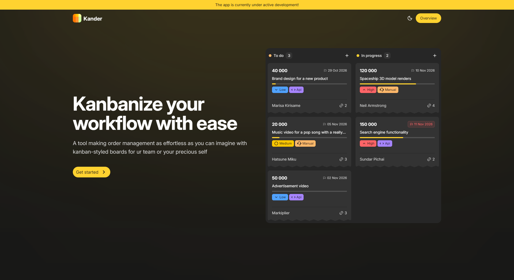
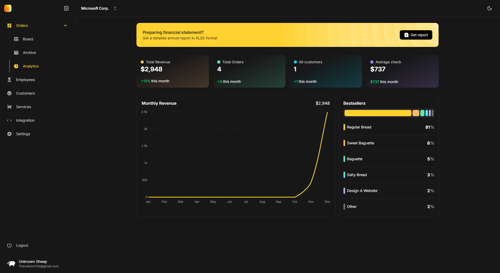
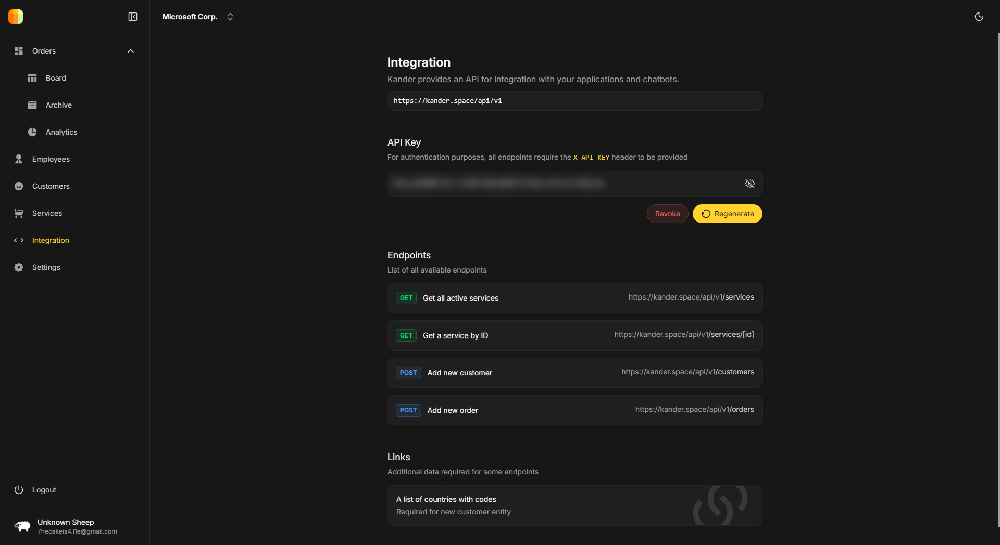

<div align="center">


### Order management for small and medium businesses, on a Kanban board.

Track every order from the first request to delivery, work with your team in real time, and see how your business is
doing.

[**Live demo → kander.space**](https://kander.space)


<br />



</div>

---

## ✨ What is Kander?

Kander is a web app that turns the chaos of incoming requests into a clear, visual workflow. Orders, clients, services
and team members live in one place. No spreadsheets, no lost messages.

It is built for studios, agencies, workshops and any small team that sells services and wants to *kanbanize* their work.

## 🚀 Features

### 🗂 Kanban board

- Drag-and-drop orders between custom columns
- Configurable workflow: add, rename, reorder and delete columns
- Priorities (`low`, `medium`, `high`), due dates, progress, price and attached links on every card
- Order items with progress tracking
- Visual marker for where an order came from: created manually or via API
- Live updates for the whole team over WebSocket

### 👥 Teams and workspaces

- Multiple workspaces under one account
- Roles: **admin** and **manager**
- Invite employees by email
- Automatic order assignment between active managers
- Several responsible people per order

### 🧾 Clients and services

- Client database (customers)
- Service catalog with active/inactive state
- Archive with restore, plus bulk cleanup by date range

### 📊 Analytics



- Key stats at a glance
- Monthly revenue chart (year to date)
- Bestsellers bar chart
- Annual report export to **Excel** (`.xlsx`)

### 🔌 Public API

Connect your website, landing page or bot and let orders land on the board by themselves.



- Per-workspace API key (generate and revoke in settings)
- Ready-to-use request examples (cURL) in the Integration page
- Endpoints for creating orders and customers, and for listing services

```bash
curl -X POST https://kander.space/api/v1/orders \
  -H "x-api-key: <YOUR_WORKSPACE_API_KEY>" \
  -H "Content-Type: application/json" \
  -d '{"title": "Logo design", "customerId": "<CUSTOMER_ID>"}'
```

### 🔐 Passwordless sign-in

Magic links by email. No passwords to remember or leak.

## 🧰 Tech stack

| Layer         | Tools                                                          |
|---------------|----------------------------------------------------------------|
| Framework     | [Nuxt 4](https://nuxt.com), Vue 3, Nitro                       |
| UI            | [Nuxt UI 4](https://ui.nuxt.com), Tailwind CSS 4, Lucide icons |
| Charts        | Chart.js, vue-chartjs                                          |
| Drag and drop | vuedraggable, LexoRank ordering                                |
| Database      | PostgreSQL, [Prisma 7](https://www.prisma.io)                  |
| Realtime      | WebSocket (Nitro)                                              |
| Email         | [Resend](https://resend.com)                                   |
| Auth          | JWT, magic links                                               |
| Validation    | Zod                                                            |
| Reports       | ExcelJS                                                        |

## 🏁 Getting started

**Requirements:** Node.js 20+, pnpm, PostgreSQL.

```bash
# 1. Install dependencies
pnpm install

# 2. Create .env with the variables listed below

# 3. Apply the database schema
pnpm prisma migrate dev

# 4. Run the dev server (http://localhost:3000)
pnpm dev
```

### Environment variables

| Variable          | Description                            |
|-------------------|----------------------------------------|
| `DATABASE_URL`    | PostgreSQL connection string           |
| `NUXT_RESEND_KEY` | Resend API key for sending magic links |
| `NUXT_JWT_SECRET` | Secret used to sign JWT tokens         |

### Scripts

| Command          | What it does                                    |
|------------------|-------------------------------------------------|
| `pnpm dev`       | Start the dev server                            |
| `pnpm build`     | Generate Prisma client and build for production |
| `pnpm preview`   | Preview the production build                    |
| `pnpm lint`      | Run ESLint                                      |
| `pnpm typecheck` | Run the type checker                            |

## 📁 Project structure

```
app/         Vue app: pages, components, composables
server/      Nitro API routes, WebSocket and utils
prisma/      Database schema
shared/      Code shared between client and server
public/      Static assets and logo
```

## 🌐 Deployment

The `master` branch is deployed to **[kander.space](https://kander.space)**.

---

<div align="center">

Made with ☕ and Nuxt

</div>
